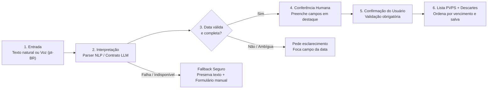

# Arquitetura Passo a Passo — Assistente de Estoque (IA)

**Tema:** Gastronomia — Insumo vencendo na cozinha  
**Protótipo separado para discussão em sala:** [htmls/agente-ia-cadastro.html](../htmls/agente-ia-cadastro.html)  
**Comparação com o fluxo manual:** [htmls/E3-mvp-validade.html](../htmls/E3-mvp-validade.html)  
**Pauta de testes:** [agente_IA.md](agente_IA.md)

---

## 1. Por que criar este experimento de IA?

Durante os testes do **MVP manual da E3**, surgiu um atrito real da cozinha: **digitar manualmente todos os campos de cada insumo dá trabalho** na correria do dia a dia — exatamente o motivo pelo qual restaurantes pequenos abandonam ERPs complexos e voltam para o caderno (achado de `P02` na [E2](../E2.md)).

O experimento testa se **descrever ou ditar o lote em linguagem natural** reduz o tempo de cadastro **sem perder confiabilidade** na data de validade.

---

## 2. Visão Geral da Arquitetura (Fluxo Completo)

---

## 3. Passo a Passo de Cada Camada

### Passo 1 — Captura da Entrada (Texto ou Voz)
* **Na interface:** o cozinheiro digita uma frase livre no campo `#nl-input` ou clica em **🎤 Falar** (`startVoiceCapture()`).
* **Tecnologia usada:** `Web Speech API` (`SpeechRecognition` / `webkitSpeechRecognition`) configurada em `pt-BR`.
* **Regra de resiliência:** se o navegador não suportar microfone ou a permissão for negada, o sistema informa e mantém o campo de texto funcionando normalmente.

### Passo 2 — Interpretação da Linguagem Natural (`interpretNaturalText`)
* **O que extrai:**
  1. **Data completa** (`DD/MM/AAAA`) com validação de calendário real (`toValidIsoDate`, rejeitando datas impossíveis como `31/02`).
  2. **Termos ambíguos de data** (*"terça"*, *"amanhã"*, *"semana que vem"*) para acionar o pedido de esclarecimento.
  3. **Código do lote** (ex.: `lote A12` → `A12`).
  4. **Quantidade e unidade** (ex.: `2 caixas`, `500g`, `3 potes`).
  5. **Local na geladeira** (ex.: `prateleira do meio`, `freezer`, `fundo`).
  6. **Nome do insumo** (removendo os metadados acima e padronizando a capitalização).
* **Evolução para LLM (API real):** no protótipo do simulado, a interpretação roda localmente em JavaScript puro para funcionar offline no GitHub Pages sem expor chave de API. Em produção, apenas essa função (`interpretNaturalText`) é substituída por uma chamada a uma API de LLM retornando JSON com o mesmo formato (`{ name, lotCode, expiry, qty, location, ambiguousDateTerm }`).

### Passo 3 — Conferência Humana (*Human-in-the-Loop*)
* **Regra de ouro:** o assistente **nunca salva o lote sozinho**.
* Ao interpretar a frase, `runAssistantParse()` preenche os campos do formulário e aplica destaque visual amarelo (`.field-suggested`) para o cozinheiro bater o olho, corrigir se quiser e clicar em **"Confirmar e salvar lote"**.

### Passo 4 — Tratamento de Ambiguidade e Falhas
* **Caso 2 (Informação ausente ou ambígua):** ex.: `"Queijo, lote B02, vence na terça"`. O assistente preenche *Queijo* e *B02*, mas bloqueia o salvamento automático, avisa que *"terça"* é ambíguo e coloca o cursor direto no campo de data.
* **Caso 3 (Falha do serviço):** botão **"Simular falha"** (`simulateAssistantFailure()`) demonstra que, mesmo se a IA cair, **o texto digitado não é perdido** e o formulário manual continua 100% operacional.

### Passo 5 — Validação, Ordenação PVPS e Visão do Dono
* Ao confirmar o formulário, a validação obrigatória bloqueia nome ou data vazios.
* Os lotes salvos entram na lista ordenada por **PVPS (Primeiro que Vence, Primeiro que Sai)** com cores de urgência (*Vencido*, *Vence hoje*, *Até 3 dias*, *No prazo*).
* O botão **Descartado** registra perdas em 1 toque no bloco **"Visão do dono"**, evitando que o prejuízo só apareça no fim do mês.

---

## 4. Um Único Agente nos 4 Estados da Dor (IA vs. Código Determinístico)

> **Decisão arquitetural (Single-Agent):** no MVP, usamos **apenas 1 agente** focado na interpretação de linguagem natural. A boa prática é deixar a **IA cuidar da linguagem e contexto** e o **código tradicional cuidar das regras exatas** (ordenação de datas e cálculos).

| Estado da dor da persona (Rafael e Dono) | Papel do mesmo agente (IA) | Papel do código determinístico |
| :--- | :--- | :--- |
| **1. Chegada / Guarda do insumo** *(atrito do caderno)* | Interpreta texto/voz (*"chegou 2 creme de leite vencendo dia 19"*) e preenche o cadastro para conferência. | Valida campos obrigatórios e formato real da data no calendário. |
| **2. Escolha antes do preparo** *(qual lote usar primeiro)* | Pode responder consultas em voz (*"o que vence hoje?"*) lendo a lista pronta. | Ordena automaticamente por **PVPS** (100% exato, sem alucinação). |
| **3. Lote perto de vencer** *(como evitar descarte)* | Lê os itens em alerta e sugere aproveitamento rápido (ex.: prato do dia). *(Evolução futura)* | Identifica matematicamente quais itens vencem em até 3 dias. |
| **4. Descarte e visão do dono** *(perda só no fim do mês)* | Interpreta o aviso de perda (*"descartei 2 potes de requeijão"*) e prepara o registro com confirmação. | Contabiliza e consolida o histórico exato de descartes para o dono. |

*(Visão de escala futura: se o sistema crescer além do restaurante pequeno, essa mesma lógica pode evoluir para 3 agentes especializados — Entrada, Alerta PVPS e Aproveitamento/Relatórios.)*

---

## 5. Como conduzir a discussão em sala
1. Mostre primeiro o **MVP manual** ([E3-mvp-validade.html](../htmls/E3-mvp-validade.html)) e meça quantos segundos leva para cadastrar 2 lotes digitando campo por campo.
2. Abra depois o **Assistente de IA** ([agente-ia-cadastro.html](../htmls/agente-ia-cadastro.html)) e teste os **3 casos** de [agente_IA.md](agente_IA.md):
   * **Teste 1 (Claro):** `"Creme de leite, lote A12, 2 caixas, validade 19/11/2026"`
   * **Teste 2 (Ambíguo):** `"Queijo, lote B02, vence na terça"`
   * **Teste 3 (Falha):** clique em **Simular falha** e mostre a continuidade pelo formulário manual.
3. Compare **tempo, taxa de acerto e segurança** com a turma para decidir se o assistente entra na versão final!
