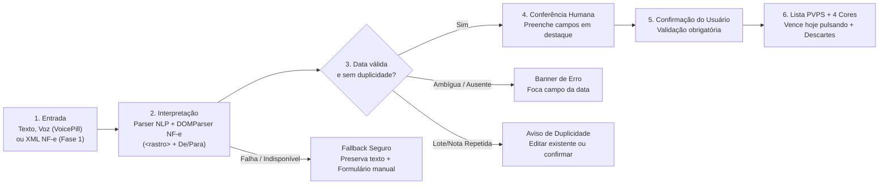

# Arquitetura Passo a Passo — Assistente de Estoque (IA) e Notas Fiscais

**Tema:** Gastronomia — Insumo vencendo na cozinha  
**Protótipo separado para discussão em sala:** [htmls/agente-ia-cadastro.html](../htmls/agente-ia-cadastro.html)  
**Comparação com o fluxo manual:** [htmls/E3-mvp-validade.html](../htmls/E3-mvp-validade.html)  
**Pauta de testes:** [agente_IA.md](agente_IA.md)  
**Roadmap fiscal detalhado (Fases 1, 2 e 3):** [integracao-notas-fiscais.md](../../docs/futuras-implantacoes/integracao-notas-fiscais.md)

---

## 1. Por que criar este experimento de IA + Entrada Fiscal?

Durante os testes do **MVP manual da E3**, surgiu um atrito real da cozinha: **digitar manualmente todos os campos de cada insumo dá trabalho** na correria do dia a dia — exatamente o motivo pelo qual restaurantes pequenos abandonam ERPs complexos e voltam para o caderno (achado de `P02` na [E2](../desafios/E2.md)).

Além disso, no Brasil, mesmo quando uma nota fiscal (NF-e/NFC-e) chega em XML, o bloco de rastreabilidade (`<rastro>` com `<nLote>` e `<dVal>`) raramente vem preenchido em alimentos. O experimento une **leitura de XML (Fase 1)** com **voz/texto natural (VoicePill)** para zerar a digitação pesada **sem perder confiabilidade** na validade.

---

## 2. Visão Geral da Arquitetura (Fluxo Completo)

---

## 3. Passo a Passo de Cada Camada

### Passo 1 — Captura da Entrada (Texto, Microfone VoicePill ou XML NF-e)
* **Voz com VoicePill:** substitui o antigo botão textual por um controle de microfone expansível (`VoicePill`, baseado em `@react-bits/VoicePill-JS-CSS`) com forma de onda em canvas, cronômetro `0:00`, suporte a toque/segurar (`mode="auto"`) e gesto **arraste para a esquerda para cancelar**, conectado à `Web Speech API` (`pt-BR`).
* **Simulações prontas para apresentação (QR Code):** 5 cenários interativos visíveis na tela (4 estados de validade + 1 erro de data ambígua) para qualquer visitante testar em segundos.
* **Importação de Nota Fiscal (Fase 1):** upload de arquivo `.xml` de NF-e (ou botão **Simular NF-e**) lido localmente via `DOMParser` (`piloto/interpretar-nfe.js` e `agente-ia-cadastro.html`).
* **Regra de resiliência:** se o navegador não suportar microfone ou a permissão for negada, a interface informa claramente e mantém o texto, as simulações e o XML funcionando normalmente.

### Passo 2 — Interpretação da Linguagem Natural (`interpretNaturalText`) e XML (`parseNfeXml`)
* **No texto/voz:** extrai data completa (`DD/MM/AAAA`) com validação de calendário real (`toValidIsoDate`), detecta termos ambíguos (*"terça"*, *"amanhã"*, *"semana que vem"*), código do lote, quantidade/unidade, local na geladeira e nome do insumo.
* **No XML NF-e (Fase 1):** extrai chave de acesso (`chNFe`), fornecedor e cada `<det>`; aproveita `<rastro>` (`nLote`, `dVal`, `qLote`) quando presente, normaliza abreviações fiscais (`QJO MUCARELA FAT 500G` → `Queijo muçarela`) e preserva insumo/quantidade da nota quando o usuário usa a voz para ditar apenas a validade e o local.
* **Evolução para LLM (API real):** a função `interpretNaturalText` pode ser trocada por uma chamada a API de LLM mantendo exatamente o mesmo contrato JSON de saída e as mesmas validações determinísticas.

### Passo 3 — Conferência Humana (*Human-in-the-Loop*)
* **Regra de ouro:** o assistente **nunca salva o lote sozinho**.
* Ao interpretar uma frase ou selecionar um item da NF-e, o sistema preenche os campos destacados (`.field-suggested`) para o cozinheiro conferir e confirmar com 1 toque em **Salvar lote**.

### Passo 4 — Tratamento de Ambiguidade, Duplicidade e Falhas
* **Data ambígua (erro):** ex.: `"Iogurte natural, lote E05, 3 potes, vence na terça"`. O assistente marca `Validade` com `aria-invalid="true"`, exibe banner vermelho de erro e exige data completa (`DD/MM/AAAA`).
* **Lote repetido e NF-e repetida:** detecta se já existe insumo + validade + lote igual (oferecendo **Editar lote existente** ou **Adicionar mesmo assim** e destacando o card na lista) e avisa se a mesma chave `chNFe` já foi importada.
* **Falha do serviço:** mesmo se a IA ficar indisponível (`simulateAssistantFailure()`), o texto digitado é preservado e o formulário manual permanece 100% operacional.

### Passo 5 — Validação, Ordenação PVPS com 4 Cores Semânticas e Visão do Dono
* Os lotes salvos entram ordenados por **PVPS (Primeiro que Vence, Primeiro que Sai)** com cores consistentes nos temas **escuro e claro**: **Roxo/Vinho** (*Vencido*), **Vermelho pulsando em alerta** (*Vence hoje*), **Laranja** (*Vence em breve*) e **Azul** (*Dentro do prazo*).
* O botão **Descartado** registra perdas em 1 toque no histórico visível ao dono.

---

## 4. Roadmap de Notas Fiscais em 3 Fases (Brasil)

1. **Fase 1 — MVP Atual (Implementada):** upload/simulação de XML NF-e no navegador (`DOMParser`), extração de `<rastro>`, trava contra nota repetida e conferência por voz (**VoicePill**). Custo zero de infraestrutura.
2. **Fase 2 — Piloto SEFAZ (Próxima entrega do piloto online):** integração com **SEFAZ Distribuição DF-e** via Certificado Digital A1 no backend seguro (recebendo `resNFe` → Ciência da Operação → download automático do `procNFe`), leitura de **QR Code da NFC-e** e tabela de **De/Para de fornecedores** no Supabase.
3. **Fase 3 — Câmera na Cozinha / Vision (Escala):** leitura da data de validade impressa na embalagem (OCR/Visão) e foto de romaneio/recibo para compras de feira e hortifrúti sem XML.

---

## 4. Um Único Agente nos 4 Estados da Dor (IA vs. Código Determinístico)

> **Decisão arquitetural (Single-Agent):** no MVP, usamos **apenas 1 agente** focado na interpretação de linguagem natural. A boa prática é deixar a **IA cuidar da linguagem e contexto** e o **código tradicional cuidar das regras exatas** (ordenação de datas e cálculos).

| Estado da dor da persona (Rafael e Dono) | Papel do mesmo agente (IA) | Papel do código determinístico |
| :--- | :--- | :--- |
| **1. Chegada / Guarda do insumo** *(atrito do caderno)* | Interpreta texto/voz (*"chegou 2 creme de leite vencendo dia 19"*) e preenche o cadastro para conferência. | Valida campos obrigatórios e formato real da data no calendário. |
| **2. Escolha antes do preparo** *(qual lote usar primeiro)* | Pode responder consultas em voz (*"o que vence hoje?"*) lendo a lista pronta. | Ordena automaticamente por **PVPS** (100% exato, sem alucinação). |
| **3. Lote perto de vencer** *(como evitar descarte)* | Lê os itens em alerta e sugere aproveitamento rápido (ex.: prato do dia). *(Evolução futura)* | Identifica matematicamente quais itens vencem em até 3 dias. |
| **4. Descarte e visão do dono** *(perda só no fim do mês)* | Interpreta o aviso de perda (*"descartei 2 potes de requeijão"*) e prepara o registro com confirmação. | Contabiliza e consolida o histórico exato de descartes para o dono. |

*(Visão de escala futura: se o sistema crescer além do restaurante pequeno, essa mesma lógica pode evoluir para 3 agentes especializados — Entrada, Alerta PVPS e Aproveitamento/Relatórios.)*

---

## 5. Como conduzir a discussão em sala
1. Mostre primeiro o **MVP manual** ([E3-mvp-validade.html](../htmls/E3-mvp-validade.html)) e meça quantos segundos leva para cadastrar 2 lotes digitando campo por campo.
2. Abra depois o **Assistente de IA** ([agente-ia-cadastro.html](../htmls/agente-ia-cadastro.html)) e teste os **3 casos** de [agente_IA.md](agente_IA.md):
   * **Teste 1 (Claro):** `"Creme de leite, lote A12, 2 caixas, validade 19/11/2026"`
   * **Teste 2 (Ambíguo):** `"Queijo, lote B02, vence na terça"`
   * **Teste 3 (Falha):** clique em **Simular falha** e mostre a continuidade pelo formulário manual.
3. Compare **tempo, taxa de acerto e segurança** com a turma para decidir se o assistente entra na versão final!
