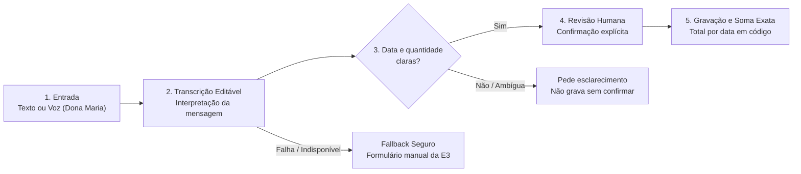

# Arquitetura Passo a Passo — Dita (Assistente de Pedidos)

**Tema:** Gastronomia — Marmita no WhatsApp  
**MVP Manual de comparação:** [htmls/E3-mvp-marmitas.html](../htmls/E3-mvp-marmitas.html)  
**Pauta de testes:** [agente_IA.md](agente_IA.md)

---

## 1. Visão Geral (Single-Agent + Código Determinístico)

## 2. Um Único Agente nos Estados da Dor (IA vs. Código)

> **Decisão arquitetural:** usar **1 único agente (Dita)** para interpretar fala/texto durante a rotina na cozinha, mantendo **a soma de marmitas por data em código determinístico** (100% exato).

| Estado da dor (Dona Maria) | Papel do agente (Dita) | Papel do código determinístico |
| :--- | :--- | :--- |
| **1. Chegada de pedido no WhatsApp** | Interpreta fala/texto (*"duas marmitas para amanhã"*) e sugere data e quantidade. | Valida data real e quantidade inteira positiva (`>= 1`). |
| **2. Mudança ou cancelamento** | Identifica a intenção de ajuste e exibe o pedido para confirmação. | Atualiza o registro sem duplicar contagem. |
| **3. Consulta da produção de amanhã** | Pode responder perguntas em voz (*"quantas marmitas para amanhã?"*). | Soma exatamente os pedidos confirmados da data selecionada. |
