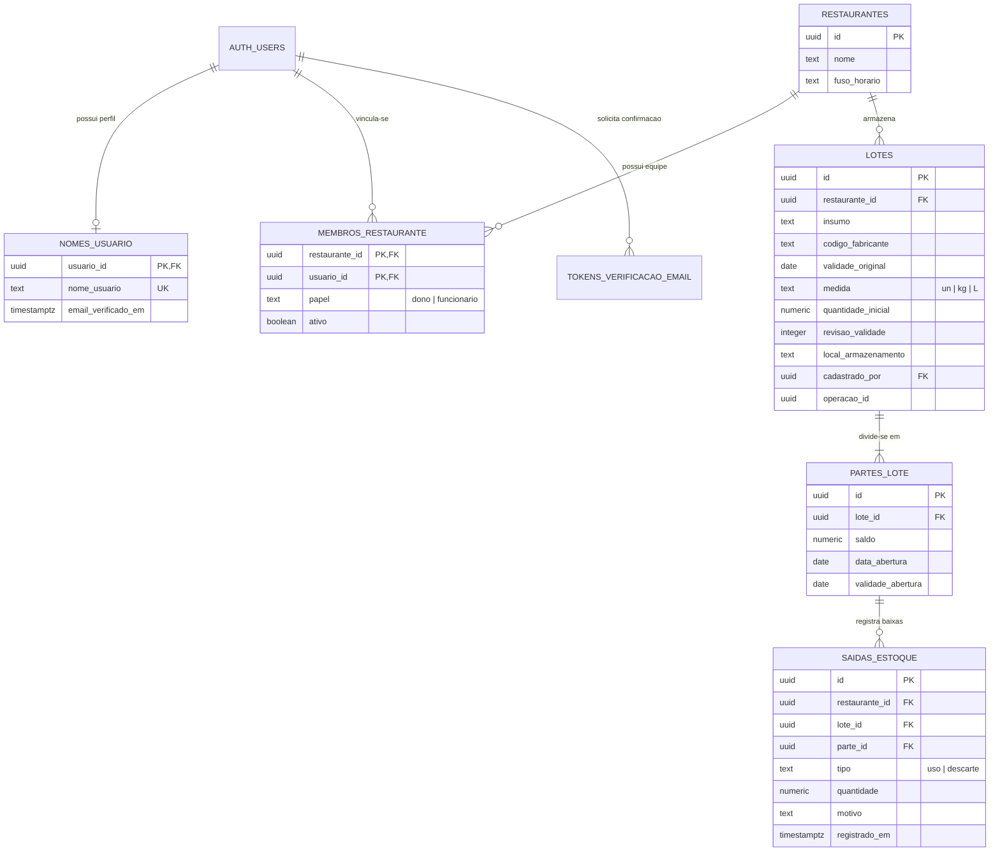

# VisionChef — modelo de dados e migrações (F03)

**Atualizado em:** 25/11/2026  
**Banco de produção:** PostgreSQL (Supabase, projeto `visionchef`)  
**Banco local / testes:** PostgreSQL embarcado via PGlite (`scripts/banco-local.mjs`)

## 1. Diagrama entidade-relacionamento

## 2. Objetos por schema e políticas de acesso

### Schema `public` (RLS habilitada em todas as tabelas)

| Objeto | Tipo | Controle de acesso | Finalidade |
| --- | --- | --- | --- |
| `restaurantes` | Tabela | `SELECT` apenas para contas com vínculo `ativo = true` em `membros_restaurante` | Cadastro de restaurantes e fuso horário de referência. |
| `membros_restaurante` | Tabela | `SELECT` apenas da própria linha ativa (`usuario_id = auth.uid() and ativo`). Escritas diretas negadas (`REVOKE`). | Autorização por restaurante e papel (`dono` ou `funcionario`). |
| `lotes` | Tabela | `SELECT` por vínculo ativo no restaurante. Escritas somente via RPCs `SECURITY DEFINER`. | Dados de origem do lote, validade da embalagem, trava otimista (`revisao_validade`) e idempotência (`operacao_id`). |
| `partes_lote` | Tabela | `SELECT` via visibilidade do lote. Escritas somente via RPCs. | Saldo independente de partes fechadas e abertas/fracionadas. |
| `saidas_estoque` | Tabela | `SELECT` restrito ao restaurante (visão de descartes filtrada ao `dono` na API). | Histórico imutável de uso e descarte, com motivo, validade aplicável e horário; o dono usa as baixas do mês no relatório de perdas. |
| `estoque` | View (`security_invoker = true`) | Herda exatamente a RLS do usuário autenticado | Projeção ordenada por `validade_aplicavel`, calculando `situacao` (`vencido`, `hoje`, `breve`, `em_dia`) no fuso do restaurante. |
| `nomes_usuario` | Tabela | Acesso direto negado a `authenticated` (`42501`); leitura/escrita apenas via funções protegidas | Nome de usuário único case-insensitive entre todos os restaurantes e carimbo opcional `email_verificado_em`. |

### Schema `private` (sem permissão para `public`, `anon` ou `authenticated`)

| Objeto | Acesso | Finalidade |
| --- | --- | --- |
| `private.limites_autenticacao` | Somente `service_role` via RPC `controle_limite_autenticacao` | Contadores de rate limit compartilhados entre instâncias serverless (`login`, `cadastro`, `confirmacao`), armazenando apenas SHA-256 da chave. |
| `private.tokens_verificacao_email` | Somente `service_role` via RPCs `emitir_verificacao_email` / `consumir_verificacao_email` | Armazena somente SHA-256 do token de 256 bits, validade de 24h e carimbo de uso único (`usado_em`). |

### Schema `visionchef_local` (exclusivo do ambiente local PGlite)

- `visionchef_local.migracoes`: controle de migrações aplicadas.
- `visionchef_local.credenciais`: hashes **Argon2id** (`scripts/senhas.mjs`) das contas locais de teste.

## 3. Funções RPC autorizadas

| Função | Quem executa | Regras principais |
| --- | --- | --- |
| `cadastrar_lote` | `authenticated` | Verifica vínculo ativo (`for share`), valida medida/inteiro e garante idempotência por `(restaurante_id, cadastrado_por, operacao_id)`. |
| `corrigir_validade` | `authenticated` | Verifica vínculo ativo e `revisao_validade` (lança `PT409` em concorrência). |
| `registrar_abertura` | `authenticated` | Separa saldo fechado em parte aberta na mesma transação; bloqueia lote vencido (`PT409`). |
| `registrar_saida` | `authenticated` | Deduz saldo atomicamente, bloqueia `uso` em lote vencido e registra em `saidas_estoque`. |
| `listar_equipe_restaurante` | `authenticated` | Exige `papel = 'dono'` e `ativo = true` no restaurante alvo (`42501` caso contrário). |
| `vincular_membro_restaurante` | `authenticated` | Exige `dono` ativo; localiza conta por usuário ou e-mail (`PT404` se inexistente); cria/reativa vínculo; impede deixar restaurante sem dono (`PT409`). |
| `remover_membro_restaurante` | `authenticated` | Exige `dono` ativo; define `ativo = false` imediatamente; protege contra remoção do último dono ativo (`PT409`). |
| `nome_usuario_proprio`, `definir_nome_usuario_proprio` | `authenticated` | Consultam ou definem apenas o nome da própria conta via `auth.uid()`; permitem substituir nomes técnicos de legado uma única vez e mantêm a unicidade case-insensitive. |
| `email_para_nome_usuario`, `controle_limite_autenticacao`, `emitir_verificacao_email`, `consumir_verificacao_email`, `estado_verificacao_email`, `email_cadastrado` | `service_role` | Chamadas apenas por Edge Functions assinadas com HMAC pelo backend. |

## 4. Histórico de migrações (`supabase/migrations/`)

- `20261124000100` a `20261124000700`: schema inicial, correção de validade com revisão, abertura/fracionamento, baixas/descartes, local de armazenamento, papel `funcionario` e `nomes_usuario`.
- `20261124000800`: rate limit persistente em `private.limites_autenticacao`.
- `20261124000900`: confirmação opcional de e-mail (`private.tokens_verificacao_email` e RPCs).
- `20261124001000` / `20261124001100`: `public.email_cadastrado` (verificação prévia na recuperação de senha, restrita a `service_role`).
- `20261124001200`: backfill e autoprovisionamento de `public.nomes_usuario` para contas criadas direto no Auth.
- `20261124001300`: RPCs de gestão de equipe (`listar_equipe_restaurante`, `vincular_membro_restaurante`, `remover_membro_restaurante`).
- `20261124001400`: tabela `public.fornecedores` com RLS e RPCs (`listar_fornecedores_restaurante`, `salvar_fornecedor_restaurante`, `alterar_status_fornecedor`).
- `20261124001500`: criação autenticada do primeiro restaurante e vínculo inicial do dono.
- `20261126000100`: RPCs pessoais para consultar e completar o nome de usuário de contas legadas sem abrir leitura direta da tabela.
