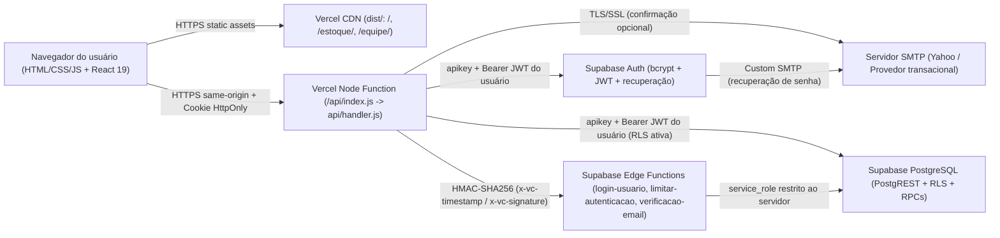

# VisionChef — contexto do sistema (F02)

**Atualizado em:** 26/11/2026
**Referências:** [ADR-001](decisions/ADR-001-arquitetura-do-piloto.md) · [ADR-002](decisions/ADR-002-autenticacao-e-emails.md) · [Contrato da API](../api/api-contract.yaml)

## 1. Atores

| Ator | Perfil / Escopo | Capacidades principais |
| --- | --- | --- |
| Visitante | Sem sessão | Navega na landing Sync (`/`), cria conta individual (`/#cadastro`) ou solicita recuperação de senha (`/#recuperar`). |
| Usuário autenticado sem vínculo | Sessão válida sem linha ativa em `membros_restaurante` | Acessa **Minha conta**, consulta status de vínculo e solicita/confirma e-mail opcional. Não acessa estoque nem equipe. |
| Funcionário (`funcionario`) | Vínculo ativo em `membros_restaurante` | Consulta lotes do seu restaurante, cadastra, corrige validade, registra abertura/fracionamento e baixas (uso/descarte). Não acessa relatório gerencial nem `/equipe/`. |
| Gerente (`gerente`) | Vínculo ativo com `papel = 'gerente'` | Ações operacionais do dono: estoque, controle de validade, relatório de desperdício, fornecedores e gestão de funcionários/gerentes. Não pode alterar o acesso de um dono. |
| Dono (`dono`) | Vínculo ativo com `papel = 'dono'` | Acesso completo, incluindo gestão de todos os perfis e dos vínculos de propriedade do restaurante. |

## 2. Fronteiras de confiança e fluxo de dados

## 3. Princípios arquiteturais ativos

1. **Zero segredo no navegador:** `dist/` não contém chaves privadas, `JWT_SECRET_KEY`, `service_role`, credenciais SMTP nem tokens Supabase. O cookie de sessão é `HttpOnly`, `SameSite=Strict` e `Secure` em HTTPS, com `Path=/api`.
2. **Defesa em profundidade no banco:** o backend sempre encaminha o JWT individual do usuário para PostgREST/RPCs; a autorização por restaurante, papel e vínculo ativo (`ativo = true`) é garantida no PostgreSQL mesmo contra requisições manipuladas.
3. **Funções privilegiadas isoladas por HMAC:** consultas que cruzam contas (resolver e-mail pelo nome de usuário, verificar existência na recuperação, rate limit compartilhado e tokens de confirmação) passam por Edge Functions que validam assinatura HMAC-SHA256 + janela de tempo.
4. **Dois caminhos explícitos de e-mail:**
   - **Recuperação de senha:** Supabase Auth → Custom SMTP.
   - **Confirmação opcional de e-mail:** API Node da Vercel (`nodemailer`) → SMTP privado (com verificação `accepted >= 1 && rejected === 0`).
5. **Paridade local fiel:** o ambiente local (`scripts/dev.mjs` + `PGlite`) aplica exatamente as mesmas migrações SQL de `supabase/migrations/` com `set local role authenticated` e `auth.uid()` por requisição, utilizando Argon2id em `scripts/senhas.mjs`.
