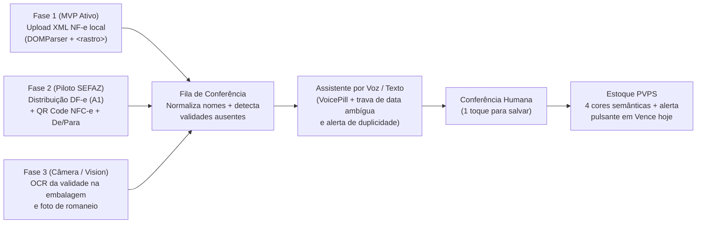

# Integração de Notas Fiscais (NF-e / NFC-e) com a Assistente do VisionChef

**Status:** Fase 1 implementada no MVP (`agente-ia-cadastro.html` e `piloto/interpretar-nfe.js`) · Fases 2 e 3 planejadas para a evolução do piloto online.

Este documento consolida o levantamento da realidade fiscal no Brasil para restaurantes pequenos e define o passo a passo técnico de implantação em **3 fases**, mantendo a regra de ouro do VisionChef: **o sistema sugere e acelera, e a pessoa na cozinha sempre confere e confirma antes de gravar**.

---

## 1. Realidade das notas fiscais de restaurantes no Brasil hoje

| Canal de compra | Documento fiscal | Como chega na prática | Traz lote (`nLote`) e validade (`dVal`)? |
| --- | --- | --- | --- |
| **Distribuidor / Atacado / Indústria** | **NF-e (Modelo 55)** | XML + PDF por e-mail/WhatsApp, DANFE impresso com código de barras (44 dígitos) ou via **SEFAZ (Distribuição DF-e)** | O layout SEFAZ 4.00 possui o grupo `<rastro>` (NT 2016.002), **mas a obrigatoriedade rigorosa concentra-se em medicamentos**. Em alimentos, a maioria dos fornecedores não preenche `<dVal>`. |
| **Atacarejo / Mercado (compra rápida)** | **NFC-e (Modelo 65)** | Cupom térmico com **QR Code** (consulta na SEFAZ estadual) | Raramente traz lote ou data de validade. |
| **Feira / Hortifrúti / Produtor local** | Romaneio / recibo / nota simplificada | Papel na entrega ou mensagem no WhatsApp | Não traz validade estruturada. |
| **Fracionamento interno na cozinha** | Etiqueta interna (PVPS / RDC 216) | Embalagem aberta ou porcionada na rotina | Definido apenas no momento da abertura dentro da cozinha. |

### Por que a Assistente do VisionChef resolve uma dor que ERPs comuns não resolvem
Mesmo quando um ERP importa o XML automaticamente, o arquivo informa **o quê** (`<xProd>`) e **quanto** (`<qCom>`, `<uCom>`) entrou, mas quase nunca informa a **validade real impressa na caixa** nem o **local na geladeira**, além de trazer descrições abreviadas (ex.: `CR LEITE UHT TP 200G CX`). Combinar **leitura fiscal (XML/QR Code)** com **conferência assistida por voz (VoicePill)** elimina digitação repetitiva sem perder segurança sanitária.

---

## 2. Arquitetura em 3 Fases (Passo a Passo)

---

### Fase 1 — Importação local de XML NF-e no MVP *(Implementada)*
**Objetivo:** entregar valor imediato sem custo de API fiscal nem certificado digital, funcionando offline no navegador.

1. **Captura:** botão **Enviar XML (.xml)** e botão **Simular NF-e (4 itens)** diretamente em `Insumo vencendo na cozinha/htmls/agente-ia-cadastro.html` (com módulo ES reutilizável em `piloto/interpretar-nfe.js`).
2. **Parser nativo (`DOMParser`):**
   - Extrai chave de acesso (`chNFe` / atributo `Id="NFe..."`), número (`nNF`), fornecedor (`emit > xFant` / `xNome`) e cada `<det>`.
   - Aproveita automaticamente o bloco **`<rastro>`** (`<nLote>`, `<qLote>`, `<dFab>`, `<dVal>`) sempre que o fornecedor preencher.
   - Normaliza nomes abreviados (`QJO MUCARELA FAT 500G` → `Queijo muçarela`) e unidades comerciais (`CX`, `PCT`, `SC`, `BD`).
3. **Fila de conferência + Assistente de Voz (VoicePill):**
   - Itens com `<rastro>` entram marcados como prontos para conferência em 1 toque.
   - Itens sem validade no XML ficam destacados como **Sem validade no XML**; ao selecionar o item e ditar no **VoicePill** (ex.: *"lote B02, validade 30/11/2026, prateleira do meio"*), a assistente preserva o insumo/quantidade da nota e completa apenas os campos faltantes.
4. **Travas de segurança ativas:**
   - **Nota duplicada:** armazena a chave `chNFe` importada e alerta caso o usuário tente importar a mesma NF-e novamente.
   - **Lote repetido:** bloqueia duplicação acidental de insumo + validade + lote, oferecendo **Editar lote existente** ou **Adicionar mesmo assim**.
   - **Data ambígua:** bloqueia termos vagos (*"vence na terça"*) e exige data exata `DD/MM/AAAA`.

---

### Fase 2 — Captura automática SEFAZ (DF-e), QR Code de NFC-e e De/Para *(Evolução do Piloto)*
**Objetivo:** eliminar até o upload manual do XML no restaurante piloto, fazendo as notas aparecerem automaticamente antes do caminhão descarregar.

1. **Certificado Digital A1 (`.pfx`) no backend seguro:**
   - Armazenado de forma cifrada fora do navegador (cofre/variáveis privadas no servidor Node/provedor fiscal parceiro como *Nuvem Fiscal*, *Focus NFe* ou *Tecnospeed* — nunca exposto ao front-end).
2. **Fluxo SEFAZ Distribuição DF-e:**
   - Job periódico consulta o Web Service da SEFAZ pelo CNPJ do restaurante usando o último **NSU** (*Número Sequencial Único*).
   - Recebe o resumo da nota (`resNFe`), envia o evento de **Manifestação do Destinatário (Ciência da Operação)** e baixa o XML completo (`procNFe`).
   - Persiste a nota em uma nova tabela `notas_fiscais_entrada` com `UNIQUE (restaurante_id, chave_nfe)` e **RLS por restaurante** no PostgreSQL/Supabase.
3. **Leitura de QR Code da NFC-e (compras de atacarejo/mercado):**
   - Câmera do celular lê o QR Code do cupom térmico, extrai a chave/URL da SEFAZ estadual e carrega os itens na mesma fila de conferência.
4. **Tabela de De/Para por fornecedor (`de_para_fornecedor`):**
   - Mapeia `(restaurante_id, cnpj_fornecedor, codigo_produto_fornecedor ou ean)` → `(insumo_padronizado, fator_conversao, medida_cozinha)`.
   - Na 1ª compra de `"CX 24UN"`, o dono confirma `× 24 un`; a partir da 2ª compra, a conversão entra automaticamente.

---

### Fase 3 — Câmera na Cozinha / Visão Computacional *(Escala — Vision)*
**Objetivo:** cobrir os casos em que não existe XML (hortifrúti, feira, produtor local) e agilizar ainda mais a leitura da data impressa nas embalagens.

1. **Leitura da validade na embalagem (OCR / Vision):**
   - Na conferência de um item sem `<rastro>`, o funcionário aponta a câmera do celular para o carimbo de lote e validade (`L: B02 / VAL: 30/11/26`).
   - O modelo de visão extrai `lote` e `validade` e preenche os campos destacados no formulário (mesmo contrato de conferência humana da Fase 1).
2. **Foto de romaneio / recibo em papel:**
   - Para entregas de feira sem NF-e, uma foto do romaneio alimenta a mesma fila de conferência da nota, aplicando validação de calendário real, bloqueio de datas ambíguas e detecção de duplicidade.
3. **Privacidade e segurança:**
   - Imagens de rótulos são processadas apenas para extrair texto da embalagem e descartadas em seguida, mantendo aderência à LGPD.

---

## 3. Resumo comparativo para apresentação

| Fase | Entrada da nota | Custo de infra | Benefício principal na cozinha |
| --- | --- | --- | --- |
| **Fase 1 (MVP ativo)** | Upload `.xml` da NF-e + Simulação pronta | **R$ 0** (roda no navegador) | Elimina digitação de itens/quantidades e já aproveita `<rastro>` |
| **Fase 2 (Piloto SEFAZ)** | Automático via SEFAZ DF-e (A1) + QR Code NFC-e | Baixo (API fiscal por CNPJ) | Nota já espera o caminhão na tela; De/Para automático |
| **Fase 3 (Vision)** | Câmera na embalagem (OCR) + foto de romaneio | Sob demanda por leitura | Cobre feira/hortifrúti sem XML e zera digitação de datas |
