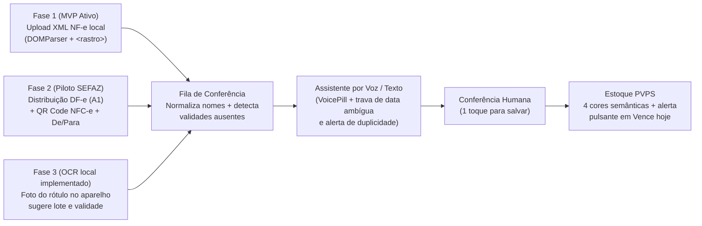

# Integração de Notas Fiscais (NF-e / NFC-e) com a Assistente do VisionChef

**Status:** Fase 1 e leitura local por câmera da Fase 3 implementadas no estoque. A captura automática SEFAZ da Fase 2 continua opcional e depende do certificado A1 do restaurante.

Este documento consolida o levantamento da realidade fiscal no Brasil para restaurantes pequenos e define o passo a passo técnico de implantação em **3 fases**, mantendo a regra de ouro do VisionChef: **o sistema sugere e acelera, e a pessoa na cozinha sempre confere e confirma antes de gravar**.

---

## 1. Realidade das notas fiscais de restaurantes no Brasil hoje

| Canal de compra | Documento fiscal | Como chega na prática | Traz lote (`nLote`) e validade (`dVal`)? |
| --- | --- | --- | --- |
| **Distribuidor / Atacado / Indústria** | **NF-e (Modelo 55)** | XML + PDF por e-mail/WhatsApp, DANFE impresso com código de barras (44 dígitos) ou via **SEFAZ (Distribuição DF-e)** | O layout SEFAZ 4.00 possui o grupo `<rastro>` (NT 2016.002), **mas a obrigatoriedade rigorosa concentra-se em medicamentos**. Em alimentos, a maioria dos fornecedores não preenche `<dVal>`. |
| **Atacarejo / Mercado (compra rápida)** | **NFC-e (Modelo 65)** | Cupom térmico com **QR Code** (consulta na SEFAZ estadual) | Raramente traz lote ou data de validade. |
| **Feira / Hortifrúti / Produtor local** | Romaneio / recibo / nota simplificada | Papel na entrega ou mensagem no WhatsApp | Não traz validade estruturada. |
| **Fracionamento interno na cozinha** | Etiqueta interna (PVPS / RDC 216) | Embalagem aberta ou porcionada na rotina | Definido apenas no momento da abertura dentro da cozinha. |

### Por que a Assistente do VisionChef resolve uma dor que ERPs comuns não resolvem
Mesmo quando um ERP importa o XML automaticamente, o arquivo informa **o quê** (`<xProd>`) e **quanto** (`<qCom>`, `<uCom>`) entrou, mas quase nunca informa a **validade real impressa na caixa** nem o **local na geladeira**, além de trazer descrições abreviadas (ex.: `CR LEITE UHT TP 200G CX`). Combinar **leitura fiscal (XML/QR Code)** com **conferência assistida por voz (VoicePill)** elimina digitação repetitiva sem perder segurança sanitária.

---

## 2. Arquitetura em 3 Fases (Passo a Passo)

---

### Fase 1 — Importação local de XML NF-e no MVP *(Implementada)*
**Objetivo:** entregar valor imediato sem custo de API fiscal nem certificado digital, funcionando offline no navegador.

1. **Captura:** botão **Enviar XML (.xml)** e botão **Simular NF-e (4 itens)** diretamente em `Insumo vencendo na cozinha/htmls/agente-ia-cadastro.html` (com módulo ES reutilizável em `piloto/interpretar-nfe.js`).
2. **Parser nativo (`DOMParser`):**
   - Extrai chave de acesso (`chNFe` / atributo `Id="NFe..."`), número (`nNF`), fornecedor (`emit > xFant` / `xNome`) e cada `<det>`.
   - Aproveita automaticamente o bloco **`<rastro>`** (`<nLote>`, `<qLote>`, `<dFab>`, `<dVal>`) sempre que o fornecedor preencher.
   - Normaliza nomes abreviados (`QJO MUCARELA FAT 500G` → `Queijo muçarela`) e unidades comerciais (`CX`, `PCT`, `SC`, `BD`).
3. **Fila de conferência + Assistente de Voz (VoicePill):**
   - Itens com `<rastro>` entram marcados como prontos para conferência em 1 toque.
   - Itens sem validade no XML ficam destacados como **Sem validade no XML**; ao selecionar o item e ditar no **VoicePill** (ex.: *"lote B02, validade 30/11/2026, prateleira do meio"*), a assistente preserva o insumo/quantidade da nota e completa apenas os campos faltantes.
4. **Travas de segurança ativas:**
   - **Nota duplicada:** armazena a chave `chNFe` importada e alerta caso o usuário tente importar a mesma NF-e novamente.
   - **Lote repetido:** bloqueia duplicação acidental de insumo + validade + lote, oferecendo **Editar lote existente** ou **Adicionar mesmo assim**.
   - **Data ambígua:** bloqueia termos vagos (*"vence na terça"*) e exige data exata `DD/MM/AAAA`.

---

### Fase 2 — Captura automática SEFAZ (DF-e), QR Code de NFC-e e De/Para *(opcional; ainda não implementada)*
**Objetivo futuro:** permitir que um restaurante que já possua certificado A1 consulte os documentos fiscais diretamente nos serviços oficiais, sem contratar intermediário fiscal.

1. **Certificado Digital A1 (`.pfx`):** necessário para autenticar o CNPJ nos serviços de distribuição DF-e. O A1 deve ser emitido por uma autoridade certificadora; essa emissão ou renovação pode ter custo, mesmo sem tarifa de API. Sem certificado, a importação manual do XML da Fase 1 continua funcionando.
2. **Integração direta:** implementar cliente SOAP no backend para os endereços oficiais da SEFAZ, com certificado e senha protegidos no servidor. O repositório ainda não consulta a SEFAZ, não guarda certificado e não manifesta notas automaticamente.
3. **Manifestação do destinatário:** exigir ação explícita de pessoa autorizada; não enviar Ciência da Operação automaticamente. O XML completo pode depender de evento de manifestação conforme as regras fiscais.
4. **NFC-e e De/Para:** QR Code varia conforme a UF e a tabela de conversão depende das unidades e dos produtos do estabelecimento. Essas duas funções ainda precisam de implementação e validação por estado antes de serem oferecidas como operacionais.
5. **Operação em produção:** habilitar somente depois de obter A1 de homologação, validar a UF e o CNPJ do restaurante, testar os serviços da SEFAZ e definir armazenamento seguro do certificado. Não há provedor ou API comercial obrigatório no desenho.

---

### Fase 3 — Câmera na Cozinha / OCR local *(Implementada no estoque)*
**Objetivo:** cobrir a leitura de lote e validade em rótulos fotografados quando o XML não traz o bloco `<rastro>`.

1. **Leitura da validade na embalagem (OCR local):**
   - Na conferência de um item sem `<rastro>`, o funcionário fotografa ou seleciona a imagem do carimbo de lote e validade (`LOTE: B02 / VAL: 30/11/2026`).
   - O Tesseract.js (Apache-2.0), com o pacote de idioma português (MIT), roda no aparelho. Os arquivos do motor e do idioma são servidos pela própria aplicação; foto e texto extraído não são enviados a uma API.
   - Marcadores explícitos `LOTE` e `VAL`/`VALIDADE`/`VENCIMENTO` são usados para sugerir os campos vazios. A pessoa revisa e salva manualmente; o OCR nunca grava um lote sozinho.
2. **Limites do MVP:**
   - A câmera sugere somente o código do lote e uma data associada a rótulos explícitos. A leitura de romaneios e a extração automática de nomes e quantidades ainda não estão implementadas; esses dados continuam sendo preenchidos por voz, texto ou pelo formulário manual.
3. **Privacidade e segurança:**
   - O arquivo da imagem permanece em memória durante a leitura e não é persistido em `localStorage`, banco ou servidor. A leitura é processada no navegador e exige conferência humana.

---

## 3. Resumo comparativo para apresentação

| Fase | Entrada da nota | Custo de infra | Benefício principal na cozinha |
| --- | --- | --- | --- |
| **Fase 1 (MVP ativo)** | Upload `.xml` da NF-e + Simulação pronta | **R$ 0** (roda no navegador) | Elimina digitação de itens/quantidades e já aproveita `<rastro>` |
| **Fase 2 (opcional)** | Consulta direta ao WS oficial SEFAZ DF-e (A1), sem intermediário fiscal | **Sem tarifa de API**; emissão/renovação do A1 pode ter custo externo | Importação automática após configuração do certificado; XML local continua disponível sem A1 |
| **Fase 3 (OCR local)** | Câmera ou foto de rótulo para sugerir lote e validade | **R$ 0 por leitura** (Tesseract.js e modelo open source, servidos pela aplicação) | Sugere lote e data para revisão; romaneios ainda exigem entrada manual |
