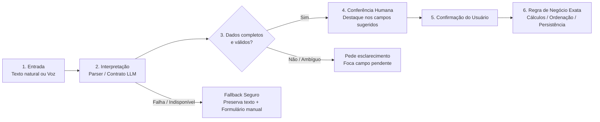

# Arquitetura Passo a Passo — Assistente de IA (Modelo)

**Tema:** [setor e nome do desafio]  
**Protótipo separado de IA:** [htmls/agente-ia-funcao.html](../htmls/agente-ia-funcao.html)  
**Comparação com o fluxo manual:** [htmls/E3-mvp-tema.html](../htmls/E3-mvp-tema.html)  
**Pauta de testes:** [agente_IA.md](agente_IA.md)

---

## 1. Objetivo do experimento
[Explique qual atrito real observado na E2/E3 o assistente tenta reduzir (ex.: digitação manual demorada na rotina corrida).]

## 2. Fluxo da arquitetura (Single-Agent + Código Determinístico)

## 3. Um Único Agente nos Estados da Dor (IA vs. Código)

> **Decisão arquitetural:** no MVP, use **1 único agente** para interpretação de linguagem natural e mantenha **regras exatas** (datas, somas, ordenação) em código determinístico.

| Estado da dor da persona | Papel do agente (IA) | Papel do código determinístico |
| :--- | :--- | :--- |
| **1. [Momento de entrada]** | [Interpretar fala/texto e sugerir campos] | [Validar campos obrigatórios] |
| **2. [Momento de consulta]** | [Responder perguntas em linguagem natural] | [Ordenar/somar com 100% de precisão] |
| **3. [Momento de decisão]** | [Sugerir ação com base nos alertas] | [Aplicar critérios matemáticos de alerta] |
| **4. [Momento de fechamento]** | [Facilitar registro de eventos] | [Consolidar totais e relatórios] |
